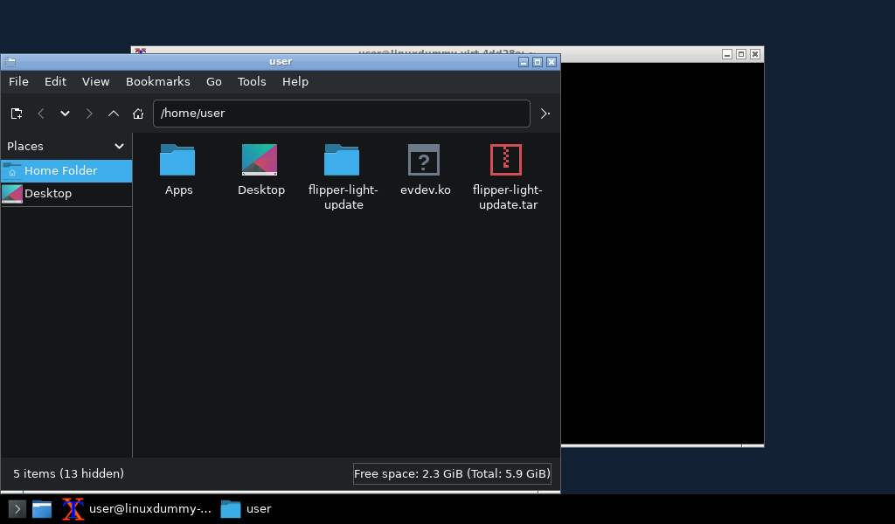

# Flipper One w QEMU — Windows 10/11

Wersja eksperymentalna 0.2. Testy QEMU wykonano na Linuksie; launcher Windows
nie został przetestowany na rzeczywistym Windows.

## Aktualizacja 0.3: lekki pulpit i poprawione wejście

Jeżeli KDE działa wolno, pobierz **[aktualizację Flipper Light (~20 MB)](https://raw.githubusercontent.com/nieznany007/nwm/v0.3/updates/flipper-light-desktop-v0.3.zip)**.
Rozpakuj ją, uruchom dotychczasowy emulator w profilu Desktop (1), a następnie
**Install-Light.cmd**. Aktualizator instaluje pakiety przez lokalne SSH i restartuje Linuksa.
Domyślne logowanie: user / user. Nie trzeba ponownie pobierać obrazu .zst.

Openbox, tint2, XTerm i PCManFM zastępują ciężką sesję KDE. Aktualizacja dodaje także
pominięty w 0.2 moduł evdev, potrzebny do obsługi klawiatury i myszy w X11.
KDE pozostaje do przywrócenia. Instrukcja: [aktualizacja 0.3](updates/light-desktop/README-PL.md).
[Testy](updates/light-desktop/TESTS.md): rozruch po restartach, okna terminala i menedżera
plików, moduł wejścia, około 240 MiB RAM w testowej VM. Windows pozostaje niezweryfikowany.

## Pobieranie i uruchomienie

1. Pobierz [cały projekt jako ZIP](https://github.com/nieznany007/nwm/archive/refs/heads/main.zip).
2. Rozpakuj pobrany ZIP do zapisywalnego folderu na Windows 10/11.
3. Zainstaluj [QEMU dla Windows](https://www.qemu.org/download/#windows).
4. Uruchom **Start.cmd**. Skrypt połączy 10 części paczki, sprawdzi SHA256,
   rozpakuje gotowy pakiet do `ready/` i uruchomi właściwy launcher.
5. Pierwszy start pobierze i zweryfikuje oficjalny obraz Flipper One build 2485 (~2 GB).
   Możesz też przeciągnąć wcześniej pobrany oficjalny `.zst` na Start.cmd.

Zostaw co najmniej 12 GB wolnego miejsca. Gdy pulpit jest czarny po zakończeniu startu,
kliknij okno QEMU i naciśnij Shift, aby wybudzić wygaszony monitor.
Panel urządzenia: http://127.0.0.1:8899/ (po uruchomieniu systemu).

Paczka jest przechowywana w `package-parts/`, ponieważ przesłanie dużego załącznika
Releases nie było dostępne w środowisku publikacji. **Nie trzeba ręcznie łączyć plików.**
`Prepare-Package.ps1` odtwarza dokładnie przetestowany ZIP i sprawdza jego SHA256.

Nie jest to pełna emulacja elektroniki. Oryginalny system plików i profile działają
z U-Bootem i kernelem dla QEMU virt. Radio, MCU i bootloader RK3576 nie są emulowane.

Instrukcja: [README-PL.md](README-PL.md). Zakres testów: [TESTS.md](TESTS.md).
Pochodzenie i licencje: [sources/PROVENANCE.md](sources/PROVENANCE.md).

SHA256 gotowego ZIP-a:
`6ff23dd736ccc88ce16b2910bc636e6b680797b78a82c1ab67e14b19eb453d09`
